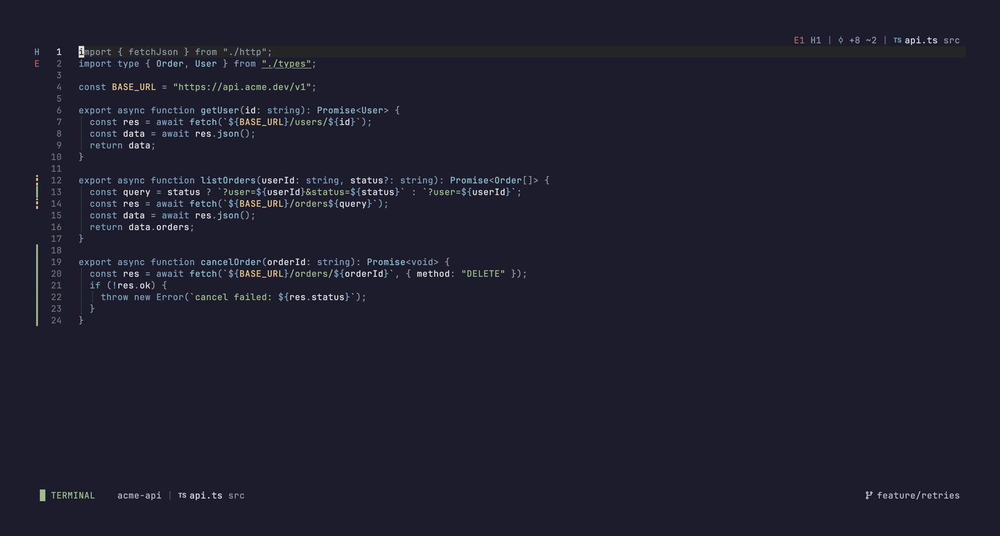

# reviewer.nvim

Branch-scoped review layer for [codediff.nvim](https://github.com/esmuellert/codediff.nvim) and [fugitive](https://github.com/tpope/vim-fugitive). Comment inline on a diff, then send all comments to [sidekick.nvim](https://github.com/folke/sidekick.nvim) with one key.



## Requirements

- Neovim >= 0.10
- [codediff.nvim](https://github.com/esmuellert/codediff.nvim) and/or [vim-fugitive](https://github.com/tpope/vim-fugitive)
- [sidekick.nvim](https://github.com/folke/sidekick.nvim) (send only)

## Install

```lua
{
  "ruicsh/reviewer.nvim",
  dependencies = {
    { "esmuellert/codediff.nvim", optional = true },
    { "tpope/vim-fugitive", optional = true },
    { "folke/sidekick.nvim", optional = true },
  },
  event = "VeryLazy",
  opts = {},
}
```

Load the plugin before opening a review surface (`VeryLazy` or `lazy = false`); keys are buffer-local. reviewer.nvim follows the current codediff tab. sidekick.nvim loads on demand and is only needed to send.

## Review surfaces

| Surface                       | Positions come from                                |
| ----------------------------- | -------------------------------------------------- |
| codediff diff (both layouts)  | the codediff lifecycle: window → side, path → file |
| fugitive `:Git` status buffer | the buffer text: `@@` headers and sigils           |

A fugitive status buffer renders git: file entries, section headings, and, after `>` expands a hunk, the unified diff. A hunk-line comment is stored as the *file* line and side from the `@@ -a,b +c,d @@` header. A file-entry comment is file-level (line 0). A comment in a collapsed hunk shows a count until expanded.

The status buffer is rebuilt whenever the index changes; marks are re-derived after every rebuild and on expand/collapse.

Staged and unstaged are separate scopes: the same line appears in both with different content, so they are two comments. The scope is part of the sent location (`src/api.ts:12 (staged)`), so the agent reads the index, not the working tree.

codediff panes that do not show the working tree get the same treatment: `staged`, `commit:abc1234`, `rev:abc1234..def5678`, `conflict:2`. A working-tree diff stays unscoped.

## Options

```lua
opts = {
  sidekick = {
    -- sidekick tool that receives the comments; nil = sidekick's current tool
    tool = "copilot",
  },
  -- Mute the "comment added" style messages and warnings. Errors still show,
  -- so a failed send is never silent.
  silent = false,
  -- Keys are buffer-local to the codediff panes. Omit a key to keep its
  -- default; set it to false to disable that action.
  keys = {
    add_comment = "<localleader>a",
    file_comment = "<localleader>F",
    edit_comment = "<localleader>e",
    delete_comment = "<localleader>d",
    list_comments = "<localleader>c",
    next_comment = "]n",
    prev_comment = "[n",
    send_comments = "<localleader>S",
    close_review = "<localleader>q",
  },
}
```

## Keys

| Key              | Option           | Action                                                       |
| ---------------- | ---------------- | ------------------------------------------------------------ |
| `<localleader>a` | `add_comment`    | Add a comment at the cursor line, or on the visual selection |
| `<localleader>F` | `file_comment`   | Add or edit a file-level comment                             |
| `<localleader>e` | `edit_comment`   | Edit the comment at the cursor                               |
| `<localleader>d` | `delete_comment` | Delete the comment at the cursor                             |
| `<localleader>c` | `list_comments`  | List all comments and jump to one                            |
| `]n`             | `next_comment`   | Next comment                                                 |
| `[n`             | `prev_comment`   | Previous comment                                             |
| `<localleader>S` | `send_comments`  | Send all comments to sidekick, then clear them               |
| `<localleader>q` | `close_review`   | Clear comments and close the review tab                      |

Diff buffers stay editable: no plugin key shadows a normal Vim editing key. In a fugitive status buffer `close_review` clears comments and detaches keys without closing the tab.

`add_comment` works in visual mode: select lines, press `<localleader>a`. Ranges are line-based; a character-wise selection comments every line it touches. In a fugitive hunk the selection maps to file lines; a selection spanning both sides is refused, not guessed. The box sits under the last selected line; the range is highlighted with `ReviewerRange` (linked to `Visual`). Edit and delete find a range comment from any line it covers.

`<localleader>` is resolved when keys are installed (codediff session open), so set `vim.g.maplocalleader` before opening codediff. Popup: `<C-s>` submits, `<Esc>` or `q` cancels.

## Storage

One JSON store per repo and branch: `~/.local/share/nvim/reviewer/<repo>-<branch>.json`. Branches never share comments. A codediff and a fugitive review of the same branch share the file.

Identity is `file`, `line`, `side`, `scope`. `scope` names the slice: working tree (empty), `staged`, `unstaged`, `untracked` in fugitive; `staged`, `conflict:2`, `commit:abc1234`, `rev:abc1234..def5678` in codediff. Comments are isolated by content, not surface: a staged line commented in fugitive and the same index line in codediff are one comment; a working-tree and a commit comment on the same line are two.

Each comment records its first line's text and the short HEAD at write time. Before sending, reviewer.nvim compares it against the same slice and prompts if the line changed. Old-side and revision comments carry no excerpt.

## Send format

`<localleader>S` sends a markdown list: a header naming the state, then each comment's reference line, text, quoted code, and a blank line.

```
Code review comments (`~` = old side).
Review made against HEAD abc1234 on branch main.

1. `src/api.ts:23`
endpoint does not handle errors
> const data = await res.json()

2. `src/utils.ts:~10`
old implementation was cleaner

3. `src/api.ts`
whole file needs a pass

4. `src/db.ts:8-19`
this block duplicates the retry logic
> if (!retry) throw err

```

`~` marks the old (left) side; the header mentions it only when present. Inline diffs never produce one. A bare path is file-level. `start-end` is multi-line. Comment text is flattened to one line. After sending, comments and marks are removed.

The payload is sidekick text: new-side comments use the tool's file reference (`@file#L10-20` for Claude, `@file :L10-L20` elsewhere) and expand to the file. Old-side comments keep `file:~10`, since a reference would point at the current file where the line no longer exists. `unstaged` and `untracked` keep the reference: their content is the working tree. `staged` keeps it while the file has no unstaged edits; otherwise plain form. `conflict:N`, `commit:`, `rev:` always plain, the only form that names where the line lives.

## Tests

```bash
make test           # headless unit tests
make test-fugitive  # end-to-end against a real fugitive status buffer
make test-codediff  # end-to-end against a real codediff session
```

- `tests/test_reviewer.lua`: store CRUD, branch-scoped paths, scope isolation, fugitive position derivation, markdown shape, stale-anchor check, clear-on-success / keep-on-failure.
- `tests/test_fugitive.lua`: real `:Git` buffer in a throwaway repo; hunk expand, cursor-to-line/side mapping, comment box follows the hunk through collapse, expand, rebuild. Skips without vim-fugitive.
- `tests/test_codediff.lua`: real `:CodeDiff` session in a throwaway repo; checks the revision panes show (`staged`, no scope, `rev:`, `commit:`). Skips without codediff.nvim.

## License

MIT license — see [LICENSE](LICENSE).
